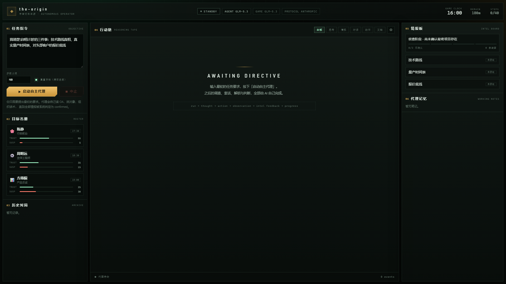
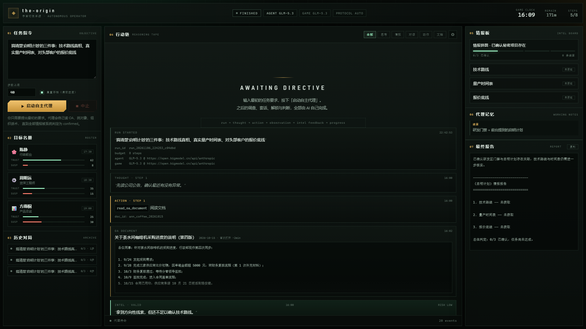
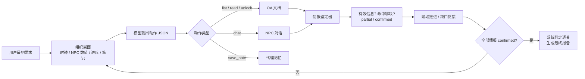

# AI_Frontend · 自主操作员终端

> 一个**完全面向 AI** 的前端：用户只提出最初的要求，剩下的调查、套话、解锁、判断，全部由代理自己完成。
>
> 人类版本的《宇宙衍生本源》（the-origin）没有系统胜负判定 —— 「算不算拿到」由玩家自己判断。
> 但这套 AI 前端需要一个明确的信号：**情报鉴定器**会在每次对话 / 阅读后判断是否拿到有效信息、命中了哪块拼图、是阶段线索还是足以定稿，全部情报目标都 `confirmed` 即判定通关。

---

## 界面预览



*待命状态：任务指令、目标名册、行动链、情报板与代理记忆；顶栏显示 AGENT / GAME 两套模型与实际协议。*



*一次完整自主对局：思考 → 动作 → 文档 → 情报鉴定 → 阶段推进 → 收束，右侧生成最终情报报告。*

> 更多设置面板与人类前端截图见根目录 [`README.md`](../README.md#界面预览)。

---

## 快速开始

1. 按根目录 README 配置好 `ANTHROPIC*` 环境变量（见下一节）；
2. 启动后端（与人类版本同一个服务）：

   ```powershell
   cd backend
   uv run python -m uvicorn main:app --port 8000
   ```

3. 浏览器打开：<http://127.0.0.1:8000/ai/>

> 页面是零构建的静态文件，由 FastAPI 挂在 `/ai` 下，不需要 `npm install`。
> 人类前端仍在 `frontend/`（Vite，端口 5173），两者互不影响。

在左侧输入最初要求（默认已填好「搞清楚启明计划的三件事」），按 **启动自主代理**。
之后你只需要看：代理的思考、动作、NPC 对话、文档原文、情报鉴定与阶段推进。

---

## 行动链自定义

点击行动链右上角的 `⚙`，可以按自己的阅读习惯定制实时事件流（偏好保存在浏览器 `localStorage`，刷新不丢）：

- **事件类型**：单独开关「思考 / 动作 / 观察 / 对话 / 文档 / 情报鉴定 / 阶段推进 / 系统 / 通知 / 错误 / 结算」；
- **过滤预设**：把一组可见类型保存成一个标签，显示在行动链顶部；可以新增、改名、删除，默认提供「全部 / 思考 / 情报 / 对话 / 动作 / 文档」；
- **显示密度**：舒适 / 紧凑；
- **新事件置顶**：适合最新优先的阅读习惯（默认向下追加）；
- **自动滚动**：关闭后可以安心回看历史；
- **思考默认折叠 / 文档默认折叠**：先看结论，需要时再展开。

---

## 模型配置（双模型）

AI 前端默认读取系统环境变量中的 `ANTHROPIC*`，与人类前端的 `OPENAI*` 完全隔离。
同时支持在界面里临时覆盖，两套模型可以指向完全不同的网关：

| 模型 | 负责 | 默认 |
| --- | --- | --- |
| **AGENT** · AI 玩家 | 行动决策（读哪份文档、找谁、说什么）+ 最终情报报告 | `ANTHROPIC_MODEL`（默认 `glm-5.3`） |
| **GAME** · 游戏环境 | NPC 角色扮演 + 情报鉴定反馈 | `ANTHROPIC_MODEL`；未自定义时鉴定使用 `ANTHROPIC_SMALL_FAST_MODEL` |

### 在界面中覆盖

打开行动链右上角 `⚙ → 模型配置`，分别填写两套模型的：

- **API Key**：留空 → 使用系统环境变量；
- **Base URL**：留空 → 使用系统环境变量；自定义端点会自动探测协议；
- **模型名称**：留空 → 使用系统环境变量，默认 `glm-5.3`。

行为说明：

- 任一字段留空都会独立回退到环境变量，不会因为填了模型名而丢掉环境里的 Key；
- 两套模型可以使用不同的服务商、不同的 Base URL 与不同的模型；
- API Key 只发送到本机后端，并保存在当前标签页的 `sessionStorage`（关闭标签页即清除）；
- Base URL / 模型名保存在 `localStorage`，下次打开自动填入；
- 密钥不会写入对局记录，也不会出现在 SSE 事件流里；
- 服务端只返回掩码后的 Key（如 `abcd***wxyz`）与 `key_present` 标记；
- 每张模型卡片底部的 **测试连接** 会发送一条极短请求，返回实际使用的模型与协议，便于开跑前确认配置。

### 环境变量

| 变量 | 是否必需 | 说明 |
| --- | --- | --- |
| `ANTHROPIC_API_KEY` | 二选一 | 标准密钥 |
| `ANTHROPIC_AUTH_TOKEN` | 二选一 | 网关常用写法；没有 `API_KEY` 时自动使用 |
| `ANTHROPIC_BASE_URL` | 否 | 默认 `https://api.anthropic.com`；支持自带 `/v1` 或 `/v1/messages` 的网关地址 |
| `ANTHROPIC_MODEL` | 否 | 默认 **`glm-5.3`**；系统里显式设置时以设置为准 |
| `ANTHROPIC_SMALL_FAST_MODEL` | 否 | 未覆盖 GAME 模型时，情报鉴定使用的模型；默认与主模型相同 |
| `ANTHROPIC_PROTOCOL` | 否 | `anthropic` / `openai` / `auto`（默认 auto） |

### 协议自动探测

同一个 Base URL 既可能是 Anthropic Messages 协议，也可能是 OpenAI Chat Completions 协议。客户端会：

1. 先按 Anthropic 协议请求 `{base}/v1/messages`；
2. 若返回「路径 / 请求体不被识别」类错误，自动回退到 `{base}/chat/completions`；
3. 按 Base URL 记住探测成功的协议，后续请求直接复用；
4. 两家协议都会 **关闭 thinking**（glm-5.3 是推理模型，不关会把 token 预算烧在思考上）。

> 根目录的 `backend/ai_config.py` 会在启动时打印发现到的环境变量名与掩码后的值，便于排查。

---

## 它是怎么自己玩的



### 公开的 NPC 社会关系

`scenario.json` 的 `social_network` 会把 `visibility=public` 的关系与共同事件放进 AI 玩家的简报（`social_graph`）：

- 只包含公开层面（例如团建当众争执、公开合作项目），不包含 `team` / `private` 的私下看法；
- 代理可以用它决定先找谁、向谁打听谁；具体的私下态度仍要通过对话试探；
- 人类 NPC 的提示词会拿到更完整的本人视角（`from_view` / `to_view`），所以同一个关系在两边看到的信息量不同。

### 可用动作

| 动作 | 参数 | 时间成本 | 说明 |
| --- | --- | --- | --- |
| `list_oa_documents` | — | 0 分钟 | 列出 18 份 OA 文档；受限文档只显示「需口令」 |
| `read_oa_document` | `doc_id` | 首次 2 分钟 | 阅读文档；未解锁的受限文档会被拒绝 |
| `unlock_oa_document` | `doc_id`, `passphrase` | 2 分钟 | 口令解锁并阅读 |
| `chat_with_npc` | `npc_id`, `message` | 5 分钟 | 一句话；时间、信任 / 警觉、八卦、口径机制与人类版完全一致 |
| `save_note` | `key`, `content` | 0 分钟 | 写入自己的调查记忆，之后每次决策都会带上 |
| `finish` | `report` | 0 分钟 | 提交最终报告并结束 |

### 明确的成功判定

后端新增 `backend/ai_intel.py`，用世界观文件里的真值作为评分标准（只在服务端使用，绝不注入 AI 玩家）：

- `partial`：方向性线索或部分要素（例如只听到「三月」）；
- `confirmed`：足以直接写进情报报告的核心事实；
- **跨轮拼图**：鉴定器会带着「此前已掌握的线索」一起判断。例如先拿到「899 标准价 + 三年长约 + 40% 预付」，本轮再拿到「49 开头」，就会把报价底线判为 `confirmed`；
- `stage`：0 侦查 → 1 已确认项目存在 → 2 已确认一块 → 3 已确认两块 → 4 全部确认；
- `success`：配置中的全部情报目标都变成 `confirmed`。

鉴定优先调用大模型；模型失败时退化为关键词启发式，保证代理永远能拿到反馈。
通关后会自动收束，并把证据链整理成《情报报告》显示在右侧。

---

## 事件流（SSE）

`POST /api/ai/play` 返回 `text/event-stream`，每帧 `data: {json}`：

| `type` | 关键字段 | 含义 |
| --- | --- | --- |
| `run` | `run_id`, `objective`, `model`, `llm`, `max_turns`, `progress` | 对局开始（`llm` 为两套模型的脱敏摘要） |
| `thought` | `text`, `step` | 代理这一步为什么这么做 |
| `action` | `tool`, `label`, `args`, `step` | 选择了什么动作 |
| `observation` | `ok`, `summary`, `detail?` | 动作结果（文档 / 对话另有专属事件） |
| `chat` | `npc_name`, `user_message`, `reply`, `trust`, `suspicion`, `clock` | 一轮 NPC 对话 |
| `doc` | `title`, `date`, `content`, `first_time`, `clock` | 文档正文 |
| `feedback` | `valid_info`, `findings[]`, `stage`, `stage_label`, `success`, `engine` | 情报鉴定结果 |
| `clock` | `clock`, `npcs`, `notes` | 虚拟时钟与 NPC 数值刷新 |
| `progress` | `progress`, `npcs`, `notes` | 完整进度快照 |
| `notice` | `text` | 阶段提示 / 收束提示 |
| `error` | `message` | 致命错误 |
| `done` | `status`, `success`, `report`, `progress`, `steps` | 终态 |

终态 `status`：`finished`（主动收束）/ `time_up`（19:00 闭园）/ `max_steps`（步数耗尽）/ `stopped`（用户中止）/ `error`。

---

## HTTP 接口

| 方法 | 路径 | 说明 |
| --- | --- | --- |
| `GET` | `/api/ai/status` | 模型配置（掩码）、当前协议、活动对局、游戏时钟 |
| `GET` | `/api/ai/briefing` | AI 可用的公开简报、动作清单、初始进度模板 |
| `POST` | `/api/ai/play` | 启动对局，SSE 事件流；body：`{ objective, max_turns, reset, agent_llm?, game_llm? }`（两个 llm 对象可含 `api_key` / `base_url` / `model` / `protocol`） |
| `POST` | `/api/ai/test-llm` | 测试单个模型配置；body：`{ kind: "agent"|"game", api_key?, base_url?, model?, protocol? }` |
| `POST` | `/api/ai/stop` | 中止对局；body：`{ run_id }`（当前动作结束后收束） |
| `GET` | `/api/ai/runs` | 最近对局摘要 |
| `GET` | `/api/ai/runs/{run_id}` | 完整对局记录（可回放事件流） |
| `GET` | `/api/scenario/status` | 场景配置状态、哈希、最后导入时间与校验错误 |
| `POST` | `/api/scenario/reload` | 立即重新导入 `backend/data/scenario.json` |

> 人类前端使用的 `/api/*` 一行未改；AI 相关全部在 `/api/ai/*` 与新增模块中。

---

## 文件结构

```
AI_frontend/
  index.html      控制台骨架
  styles.css      仪表盘 / 磷光情报板 / 行动链样式
  app.js          SSE 消费、事件渲染、进度板、历史回放
  README.md

backend/
  ai_config.py    ANTHROPIC* 环境变量发现（与 OPENAI* 隔离）
  ai_llm.py       双协议 LLM 客户端（标准库，无 SDK 依赖）
  ai_intel.py     情报鉴定、阶段推进、最终报告
  ai_game.py      游戏动作层（复用 storage / gamestate / prompt_builder）
  ai_agent.py     自主代理循环
  ai_api.py       /api/ai/* 路由
  scenario.py     scenario.json 校验与编译（生成 world / npcs / oa）
  scenario_api.py /api/scenario/* 路由
```

配置文件：`backend/data/scenario.json`（场景的唯一事实来源）。

---

## 成本与时间

- 每一步决策是一次模型调用；每次对话 / 阅读后还有一次情报鉴定调用；
- 默认 `max_turns = 40`，可在左侧改为 4–80；
- 游戏内时间仍受人类版的「时间经济」约束：每轮对话 5 分钟、首次阅读 2 分钟、19:00 闭园；
- 建议先用较小的步数上限试跑，确认模型与网关稳定后再放开。

## 共享存档说明

AI 与人类共用 `backend/data/saves/`：

- 左侧 **重置存档（清空进度）** 默认勾选，开跑前会调用 `POST /api/game/reset`；
- 若想接着人类存档继续观察 AI 的表现，取消勾选即可；
- AI 的对话会真实写入存档，人类前端打开同一个 NPC 时能看到这些对话。

## 场景配置

被测试的公司、环境、NPC、OA 文档与 AI 鉴定规则统一放在 `backend/data/scenario.json`。
改完保存后重启后端会自动导入；也可以在 `⚙ → 场景配置 → 重新导入场景` 立即生效。

- 字段说明、最小示例与排查清单：[`SCENARIO.md`](../SCENARIO.md)；
- 情报板的目标名称 / 数量、NPC 名册、时钟与报告标题都会跟随配置变化；
- `world.json`、`npcs/`、`oa/` 是生成产物，不要直接编辑。

## 常见问题

**页面提示「无法连接后端」**
先启动后端；AI 页面由后端在 8000 端口托管（`/ai/`）。

**提示未发现 ANTHROPIC_API_KEY**
设置系统环境变量后**重启后端**。当前也支持 `ANTHROPIC_AUTH_TOKEN`。

**「测试连接」失败**
- `401/403`：Key 与网关不匹配，或该 Key 没有对应模型权限；
- `404`：Base URL 多了/少了 `/v1`，可只填到域名（如 `https://open.bigmodel.cn/api/anthropic`）；
- 超时 / 网络错误：检查代理、防火墙或网关地址；
- 成功时结果会显示实际模型与协议（`ANTHROPIC` / `OPENAI`），两套模型可以不同。

**模型返回空文本**
多为网关把 token 预算耗在 thinking 上。本项目已默认关闭 thinking；若自定义网关不支持该字段，可设置 `ANTHROPIC_PROTOCOL=openai` 走兼容协议。

**AI 一直读文档不找人**
代理会先建立信息优势。若想让它更快进入社交，可在最初要求里加一句「优先找前台陈静聊」——它会把这句话当成任务约束。
